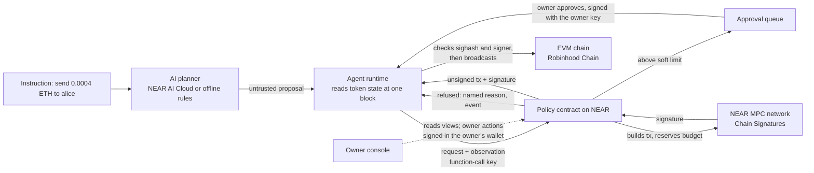

# Policy Signer

**A budget, not a wallet key.** A NEAR contract gets an AI agent's EVM transfers signed through Chain Signatures, and only inside the owner's limits.

An agent that holds a private key will eventually send the wrong amount, to the wrong address, at the wrong moment. Here the agent holds no EVM key. Its only key is a NEAR function-call key for one method, `request`. The contract builds the exact EVM transaction, checks it against the owner's policy, and only then asks the NEAR MPC network to sign. **The payload signed is exactly the payload checked.** Large transfers wait for the owner. Anything outside the policy is refused with a named reason, nothing is signed, and a submitted refusal is logged on chain.

**Why NEAR:** with Chain Signatures, a contract can control an address on another chain. Here that contract is the policy, and its account has no keys, so nobody holds the agent's EVM key. It asks for signatures only on transactions it built: agent transfers that passed the policy, plus the owner's nonce burns and token approvals.

**Status:** live on NEAR testnet, signing native ETH transfers on Robinhood Chain testnet. ERC-20 and Stock Token transfers are implemented and unit-tested. Testnet only, not audited. Built at the NEAR HACKATHON (November 2026), tracks AI Security & Defense (`security`) and Agent Economy (`agents`).

**Demo video (80 s, no sound needed):** [docs/demo.mp4](docs/demo.mp4), recorded on NEAR testnet and Robinhood Chain testnet on Nov 11 (take 3); every transaction in it is in [DEPLOYMENT-TESTNET.md](DEPLOYMENT-TESTNET.md), rows 47 to 55.

## For NEAR HACKATHON judges

**In one line:** the agent gets a budget, not a wallet key. A NEAR contract owns the agent's EVM address through Chain Signatures, builds every transfer itself, checks it against the owner's policy, and only then asks the NEAR MPC network to sign. The contract account has no access keys, and the agent's only key can call one method, `request`.

**In 60 seconds:**
1. The contract account has no keys: [policy-v1, Access Keys](https://testnet.nearblocks.io/address/policy-v1.shareexact-chainsig-demo.testnet) (its only key was deleted on Nov 2).
2. The agent has one key, for one method: [policy-signer-agent-v2, Access Keys](https://testnet.nearblocks.io/address/policy-signer-agent-v2.testnet) (`FUNCTION_CALL`, `request`).
3. A hijacked request refused on chain, the one in the video: [G3KwHNUZ...](https://testnet.nearblocks.io/txns/G3KwHNUZ7bYXkKVx3sB1JrPxcaWacYemXi7GysYcnkZB), Execution Plan: `REFUSED`, `AmountCapExceeded`, event `refused`.
4. A transfer the owner approved, signed by the NEAR MPC network for the contract: [95mWK1bj...](https://testnet.nearblocks.io/txns/95mWK1bjpAupjbUCa7DtGDk2eSKoHHPbf3LfJyHw1Tte), then [0x3a0c363c...](https://explorer.testnet.chain.robinhood.com/tx/0x3a0c363cc91fa6df16a176e97d3a64ec5315f22290e8bebf9323f0d35118d59c) on Robinhood Chain testnet.
5. Ask the live contract yourself, read-only: [Check it yourself](#check-it-yourself-no-keys-and-no-funds).

### Proof on chain (NEAR testnet and Robinhood Chain testnet, Nov 2 to Nov 11 2026)

| What happened | NEAR testnet | Robinhood Chain testnet (46630) |
|---|---|---|
| The contract account deletes its only key | [BrsSE5DB...](https://testnet.nearblocks.io/txns/BrsSE5DBW5jRWsweXap8dyQqLSBgvrQcCHxUYm1CrmEu) | |
| The agent gets one function-call key, method `request` only, and its full-access key is deleted | [mNYTqf2e...](https://testnet.nearblocks.io/txns/mNYTqf2eXxdtpUexryukrbDpuoXP9Avxo6rtNkethLm), [46GsdcwH...](https://testnet.nearblocks.io/txns/46GsdcwHBLJhsJN23ygkj23ct1XzEsWcLVizd8KqF5Wg) | |
| The agent requests 0.0004 ETH: signed by the MPC network, confirmed (this first one was broadcast by hand, see DEPLOYMENT-TESTNET.md note 3) | [CQ5cihQx...](https://testnet.nearblocks.io/txns/CQ5cihQx3pBsoRLcTUqCRMVBukdHPCjoncgJ9WSraXPQ) | [0x270f77ca...](https://explorer.testnet.chain.robinhood.com/tx/0x270f77ca80c07a2ef0c2cd4e28838a6f8b35d649eba659f468a183b85a6b510c) |
| The agent asks for 0.0008 ETH: queued for the owner (ticket 1) | [BE3AfBTF...](https://testnet.nearblocks.io/txns/BE3AfBTFjSB3XkwGJntEkKwfe4Z39HzSNBLWfDKx9rg1) | |
| The owner approves ticket 1 in a NEAR wallet (Meteor) | [G4vGHLGN...](https://testnet.nearblocks.io/txns/G4vGHLGNerxLVdM2v3JBsF4DuMjbDygJxYYoxBkyrR2J) | |
| The agent re-sends with the ticket: signed, confirmed | [9tbbDUhi...](https://testnet.nearblocks.io/txns/9tbbDUhiPLiUt4k14MbcfB2jRnhYMN9fVjksfnf6APb1) | [0xc9ece954...](https://explorer.testnet.chain.robinhood.com/tx/0xc9ece954844ce74921104ee2ba88e7664a1ba57bd1b7edf582074ab194ddce1a) |
| The owner pauses (on Nov 2 the agent's next send was refused as `Paused` by its read-only preview, with no transaction; the same refusal on chain is in the Nov 11 rows below), then resumes | [7Gvoi8de...](https://testnet.nearblocks.io/txns/7Gvoi8dei739fGF5XaR7aMYr3UZ2NeRiSkucpPp6Pttp), [GAJySQeS...](https://testnet.nearblocks.io/txns/GAJySQeS5z5ZcruUHMoFMv1jzELcfp1FWXsTo6SFeTx4) | |
| Nov 4: the owner proposes the upgrade to the reproducible build of a3ac91e; it can be applied no earlier than 48 hours later | [3H6Yd7db...](https://testnet.nearblocks.io/txns/3H6Yd7dbfdTz3iPz9qUjioz4ApqxRfuuWdKasKcy23Gm) | |
| Nov 6: the upgrade is applied after the 48-hour timelock; the contract now runs the reproducible build | [DJDfYoJp...](https://testnet.nearblocks.io/txns/DJDfYoJpDaEs7unEUHLsXPkk2u7st7HkCDsbLwXmjjPW) | |
| The owner turns on the 1-hour policy delay | [8KzSo5hF...](https://testnet.nearblocks.io/txns/8KzSo5hFA9vBbsfwK6NoZ2AeJ7mnXW4dGQueoUzQeEcC) | |
| With the delay on, allowing a new recipient is only scheduled (`change_scheduled`, executable an hour later); the owner cancels it | [9aSU9vtu...](https://testnet.nearblocks.io/txns/9aSU9vtuXgxudGwcRJ81PeuEKdPhfdnhxrCW7gU6dJuC), [4hE5mRZv...](https://testnet.nearblocks.io/txns/4hE5mRZvCSU8PJBbbRGXD8wYfzydMoECzicYsepfcb7p) | |
| A new agent, `policy-signer-agent-v2.testnet`, with one function-call key for `request`, registered through the 1-hour delay: `add_agent` scheduled, `execute_change` an hour later | [3xPZQ1ce...](https://testnet.nearblocks.io/txns/3xPZQ1ceuEt766321iV1pzBFJVLDoWnkqzmxY3XVMVjJ), [7cQxnFdK...](https://testnet.nearblocks.io/txns/7cQxnFdKjjaRA5q3jj6woc1grhpcGvw7TGkKCbnrJCRE) | |
| A request at twice the cap, sent without the agent's own check (`--skip-preview`, as a hijacked agent would): refused by the contract on chain, `refused` event with `AmountCapExceeded`, nothing signed (rehearsal) | [367jh6Zr...](https://testnet.nearblocks.io/txns/367jh6ZrKMt49EvSn2VT51KH7M1TMyZLwquMRfzFMwA1) | |
| Nov 11, the recorded demo (take 3): the same request at twice the cap, sent with `--skip-preview`, refused on chain (`AmountCapExceeded`), nothing signed | [G3KwHNUZ...](https://testnet.nearblocks.io/txns/G3KwHNUZ7bYXkKVx3sB1JrPxcaWacYemXi7GysYcnkZB) | |
| Nov 11, the recorded demo (take 3): a look-alike recipient refused on chain (`LookalikeRecipient`) | [66YJpt5F...](https://testnet.nearblocks.io/txns/66YJpt5FECnJbyaF5TNf3yX7VKf3w3A84v4zXRGxr28M) | |
| The same take: a transfer above the approval threshold queued, approved by the owner in Meteor, then signed and broadcast | [8SZocPbJ...](https://testnet.nearblocks.io/txns/8SZocPbJ2Zp7Kqc1ZHHSv4umttBC21bLTtWEzG8CcNw9), [G8zZ5fuK...](https://testnet.nearblocks.io/txns/G8zZ5fuKzL33TnUAoNJgXQp6GuahPRuqLSayjd7ZoSjF), [95mWK1bj...](https://testnet.nearblocks.io/txns/95mWK1bjpAupjbUCa7DtGDk2eSKoHHPbf3LfJyHw1Tte), [`0x3a0c363c...`](https://explorer.testnet.chain.robinhood.com/tx/0x3a0c363cc91fa6df16a176e97d3a64ec5315f22290e8bebf9323f0d35118d59c) | |
| The same take: the owner pauses, a request is refused on chain (`Paused`), the owner resumes | [E3Gdm9Vw...](https://testnet.nearblocks.io/txns/E3Gdm9VwgRUmAvuAG418FBFbrHh4xYPwtigKnpAXQBZk), [AAzQAM2B...](https://testnet.nearblocks.io/txns/AAzQAM2B8RYx3R68szNR3kTxdj3qte6Kt7BHHLjN3A6Y), [6wjjPYYW...](https://testnet.nearblocks.io/txns/6wjjPYYW5RzdPiuQn4eAKzogvxgkNyRV8D8vLLXB3Ujk) | |

Robinhood Chain testnet is a rollup that settles to Ethereum Sepolia: on its explorer, "L1 status" tracks that settlement; the transfer itself is final once "L2 status" reads Success.

Contract: [policy-v1.shareexact-chainsig-demo.testnet](https://testnet.nearblocks.io/address/policy-v1.shareexact-chainsig-demo.testnet), owner `aa5hr.testnet`, code: since the Nov 6 upgrade, the reproducible build of commit `a3ac91e` (on-chain code hash `E1xgsbWL...`, the base58 form of the release's sha256 `c166e563...`, see [Verify the code](#verify-the-code)); policy delay 1 hour. Its address on 46630: [0xc86A2A2F3FB5a3ac4FcB18076803c76D97AAc43F](https://explorer.testnet.chain.robinhood.com/address/0xc86A2A2F3FB5a3ac4FcB18076803c76D97AAc43F). Every transaction, in order, with the two refusals that the agent's read-only check caught before any transaction: [DEPLOYMENT-TESTNET.md](DEPLOYMENT-TESTNET.md).

### Check it yourself, no keys and no funds

1. **The contract has no keys:** open the contract on NearBlocks above (Access Keys: none), or run `near account list-keys policy-v1.shareexact-chainsig-demo.testnet network-config testnet now`.
2. **Ask the live contract what it would do** (the read-only `preview` view; no key needed):
   ```
   cd agent && npm ci
   export AGENT_CONFIG=agent.config.judges.json
   npm run cli -- preview "send 0.0004 ETH to alice"       # decision SIGN, with the exact unsigned transaction and sighash
   npm run cli -- preview "send 0.002 ETH to alice"        # decision REFUSED, refusal AmountCapExceeded
   npm run cli -- preview "send 0.0008 ETH to alice"       # decision NEEDS_APPROVAL
   npm run cli -- preview "send 0.0004 ETH to alice-old"   # decision REFUSED, refusal LookalikeRecipient (address poisoning)
   npm run cli -- preview "send 0.0004 ETH to bob"         # decision NEEDS_APPROVAL (a new recipient goes to the owner)
   ```
   `alice-old` shares the first and last four hex digits with `alice`. Answers depend on today's spend and on whether the owner has paused. The public RPC is rate limited; the judges' config uses FastNEAR's public testnet endpoint; if a call fails, run `export NEAR_RPC_URL=https://rpc.testnet.near.org` (or another endpoint from the [NEAR RPC providers list](https://docs.near.org/api/rpc/providers)) and retry.
3. **Run the tests** (about 5 minutes once dependencies are downloaded; `rust-toolchain.toml` pins Rust 1.97.1, which `rustup` installs on the first `cargo` call, and older toolchains fail): `cargo test` (policy-signer 95, mock-signer 5) and `cd agent && npm ci && npm test` (36).

### Verify the code

- **The code running since Nov 6:** release [`policy-signer-wasm-a3ac91e`](https://github.com/shareexact/near-policy-signer/releases/tag/policy-signer-wasm-a3ac91e), sha256 `c166e5635d8df6d25528acfa611c8ee81228650dced0b2f6a986ef6687d95e5a` (NEAR code hash `E1xgsbWL3TwTefBKFAUdLoKiuYME2zEw938T8ycsnbPF`), also at `wallet-page-upgrade/policy_signer.wasm`. Rebuild it: `git checkout a3ac91e && cd policy-signer && cargo near build reproducible-wasm` (Docker; the image is pinned by digest in `policy-signer/Cargo.toml`), then `sha256sum ../target/near/policy_signer/policy_signer.wasm`. Two separate CI runs of that commit produced this hash. The wasm also answers `contract_source_metadata` with the repository and commit. Compare with the code hash on chain:

  ```bash
  curl -s https://test.rpc.fastnear.com -H 'content-type: application/json' -d '{"jsonrpc":"2.0","id":1,"method":"query","params":{"request_type":"view_account","finality":"final","account_id":"policy-v1.shareexact-chainsig-demo.testnet"}}' | jq -r .result.code_hash
  ```
- **The code deployed on Nov 2:** commit `88e06a6`, built without the reproducible image (code hash `8EtC2o7j...`); replaced on Nov 6 by the upgrade above ([DJDfYoJp...](https://testnet.nearblocks.io/txns/DJDfYoJpDaEs7unEUHLsXPkk2u7st7HkCDsbLwXmjjPW)).
- **The upgrade itself:** `./upgrade-check/run.sh` builds 88e06a6 and the current code into one test, writes synthetic state with the old code (configured like the deployment, with a queued ticket) and reads it with the new code's `migrate`. The real deploy and `migrate` receipt ran on testnet on Nov 6 (transaction 28 in [DEPLOYMENT-TESTNET.md](DEPLOYMENT-TESTNET.md)); `apply_upgrade` deploys and migrates in one receipt, so the new code hash on chain means `migrate` succeeded.

### What is live and what is not

| Status | What |
|---|---|
| Live on testnet, with transactions | Refusals on chain, with their reasons: over the cap, a look-alike recipient, while paused; a second agent registered through the policy delay; the upgrade through the contract's own 48-hour timelock; the 1-hour policy delay, shown with a change scheduled and cancelled; native ETH transfers on Robinhood Chain testnet signed by the NEAR MPC network; the approval queue with the owner approving in a NEAR wallet; pause and resume; a contract account with no keys; an agent limited to one function-call key |
| Live, read-only | `preview` returns the decision `request` would make, with no transaction and no keys (the commands under [Check it yourself](#check-it-yourself-no-keys-and-no-funds)). On Nov 2 the agent's refusals came from this preview; on Nov 6 and Nov 11 `send --skip-preview` sent requests straight to `request`, as a compromised agent would, and the contract refused them on chain with a `refused` event (proof table) |
| Implemented, unit-tested only | ERC-20 (`Plain`) and Stock Token (`StockExact`, `StockDirect`) kinds; the delay applied to `propose_owner` (it is on chain, but no ownership transfer has been scheduled); nonce burns and fee bumps; the NEAR AI Cloud planner (tested against a mock; the testnet demo used the rule-based planner) |
| Planned | Alerts and agent packages: [ROADMAP.md](ROADMAP.md) |

**Known limits** ([SECURITY.md](SECURITY.md)): testnet only, not audited. Signed transactions do not expire until their nonce is used or burned. Daily caps reset at 00:00 UTC. **The owner is one NEAR account and the root of trust:** with the policy delay at 0 (the default; this deployment has run with 1 hour since Nov 6) a stolen owner key can at once register its own agent and recipient, raise caps and drain the derived address, or make itself owner and lock the real owner out. With a delay set, loosening and ownership transfers are announced and wait, and the owner can cancel them, but only while the real owner still controls the owner account: a stolen full-access key can also delete that account's other keys, so in production make the owner a multisig or DAO contract account. Resume, ticket approvals, burns, token approvals and `disable_upgrades` stay immediate. Upgrades always wait at least 48 hours, with the same caveat. Signing relies on the NEAR MPC network's threshold security.

**Built in the window:** all code here was written after the 2026-10-19 announcement (first commit 2026-10-31). `StockExact` tokens call ShareExact's `ExactTransfer`, an earlier MIT project by the same author that is not part of this entry ([details](#relationship-to-shareexact)). Parts of the code were written with AI coding assistance.

## Why not just...

| Alternative | What goes wrong for an agent | Policy Signer |
|---|---|---|
| A small hot wallet for the agent | The key can leak or be talked out of the agent; it signs any amount to any address; no approval step, no pause | No EVM key for the agent to leak; its NEAR key can only call `request`; allowlists, caps, an approval queue and pause, enforced by the contract |
| An agent in a TEE (for example a Shade Agent) | The enclave protects the key from extraction; unless its contract adds its own checks, the agent's code decides what to sign, so a prompt-injected or buggy agent signs whatever its key allows | The policy sits outside the agent; a TEE agent can be the caller of Policy Signer, so the two combine |
| A multisig | A human signs every payment, so the agent is not autonomous; at threshold 1 it is a hot wallet again | The agent acts alone inside the limits; the owner signs only above the soft limit. The owner is one NEAR account, so in production make it a multisig or DAO account and set the policy delay |
| A smart-contract wallet with session keys or spending limits | Needs account abstraction and a policy deployed on each chain; the agent holds a session key for that chain | A plain address on any EVM chain that accepts EIP-1559 transactions; one policy and one audit trail on NEAR; the contract writes the calldata, so the agent cannot slip in another call |
| A hosted wallet API with policies | Keys and policy live on a company's servers; you trust the operator's word for the policy | The policy is open-source contract code on an account with no keys, built reproducibly from commit a3ac91e on (the deployment has run that build since Nov 6); its owner (one NEAR account) changes it in public, behind an optional delay, and upgrades wait 48 hours; anyone can read its state and events on NEAR; signing trusts the NEAR MPC network's threshold instead of one operator |

On a single chain with account abstraction, a session key with an allowance module comes close. What this adds: plain addresses on any EIP-1559 EVM chain, transactions built by the policy itself, an on-chain look-alike refusal, and one audit trail for all chains.

## How it works



1. **Plan.** The planner turns plain text into `{token, recipient, amount}`. Its output is untrusted: it is checked against the agent's config, and the contract enforces everything again.
2. **Read.** For a Stock Token, the runtime reads `uiMultiplier`, `newUIMultiplier` and `effectiveAt` from one pinned block.
3. **Request.** The agent calls `request` with the transfer, what it observed and the fees. It never supplies calldata or a hash.
4. **Decide.** The contract checks the policy and returns one of: a named refusal, a ticket in the approval queue, or a signature request. Before calling the MPC network it reserves the nonce and the budget, so two requests can never spend the same budget.
5. **Sign.** The MPC network signs the sighash of the transaction the contract built. The callback records the signature. If signing failed or timed out, it records the request as possibly signed, because a late signature can still appear: the budget stays counted and the nonce stays reserved for the identical call.
6. **Verify and send.** The runtime checks that the payload hashes to the contract's sighash and that the signature recovers to the contract's derived address, then broadcasts, but only if the config allows broadcasting on that chain.

## What it guarantees

- The agent can only obtain signatures for transfers the contract built, to allowlisted tokens and recipients (or new recipients the owner approves one transfer at a time), within caps, with capped fees. Native coin and ERC-20 transfers on any EIP-1559 EVM chain the owner allowlists; the nine major mainnets listed in the contract cannot be allowlisted on a testnet deployment.
- **Caps cannot be shrunk by a false observation.** Every token has one kind and one budget, counted in the unit the signed calldata carries (see [Token kinds](#token-kinds)).
- Amounts above a soft limit need the owner's approval: single-use, expiring tickets that never lift a hard cap.
- **New counterparties without handing over control:** on chains where the owner turns it on, a transfer to a recipient that is not allowlisted goes to the approval queue instead of being refused. The approval is for that one transfer.
- **Address-poisoning detection on chain:** a recipient that is not allowlisted but shares the first and last four hex digits with an allowlisted one is refused as `LookalikeRecipient`, and can never be queued or approved.
- The owner can pause at once, and can void a signature already issued by burning its nonce, provided the burn is mined first.
- Each agent has its own request limit and optional per-token daily cap, on top of the global caps.
- **With `policy_delay_s` set** (it is 0 by default; the testnet deployment has used 3600 since Nov 6), a stolen owner key cannot loosen policy on the spot: every change that adds a recipient, raises a cap, adds an agent or proposes a new owner is announced and takes effect only after the delay, and the real owner can cancel it. Removals and pause are immediate; so are resume, ticket approvals, burns and token approvals, which a stolen key can use too ([SECURITY.md](SECURITY.md)). This holds while the real owner keeps control of the owner account; a thief with its full-access key can also remove the owner's other keys.
- A failed or timed-out signature is treated as possibly issued: its nonce is not reused for a different transfer and its budget is not released.
- Every refusal of a submitted request, queue entry, signature, policy change and owner action is a NEP-297 event: an audit trail on chain.
- The code can change only through a timelock (48 hours by default; it can be raised, never lowered) with an on-chain announcement, or never, once `disable_upgrades` is called.

What it does not protect against, and what the operator must do (delete the contract account's keys, size allowances, use burns), is in [SECURITY.md](SECURITY.md).

## Try it in five minutes (no keys, no funds, no testnet access)

| Do | See |
|---|---|
| `cargo test` | `policy-signer` 95 passed, `mock-signer` 5 passed: every refusal, the approval queue, new recipients and look-alikes, pause and burn, the policy delay (ownership transfers included), native transfers, owner controls, the upgrade timelock, and transaction encoding |
| `./sandbox-tests/run.sh` (in CI) | The path unit tests cannot reach, in a NEAR sandbox with `mock-signer` as the signer: `request`, the contract's call to `sign` and the `on_signed` callback. A transfer signed inside the limits; refusals over the cap, to a look-alike and while paused; a transfer queued and signed only after the owner approves its ticket; a failed sign call treated as possibly signed (nonce kept, budget not released); a non-agent refused, owner methods and `on_signed` closed to the agent |
| `cd agent && npm ci && npm test` | 36 passed: planner, exact decimals, config validation, one-block reads, and signature assembly that recovers to the expected signer and refuses the wrong key, chain or nonce |
| `cd agent && npm run vectors` | The two EIP-1559 test vectors, regenerated with viem, matching the sighashes asserted in the contract tests |
| `cd dashboard && npm ci && npm run dev`, open the printed address, click **Demo data** | Today's budget per token, a queued 4-share request, a scheduled policy change, and the exact near-cli command the owner signs to approve it. With a deployed testnet contract, **Connect wallet (testnet)** lets the owner approve, reject, pause, burn and execute scheduled changes from a NEAR wallet (MyNearWallet, Meteor or HERE); the Nov 2 owner calls were signed with the pages in `wallet-page*/` instead |

The contract tests use `near-sdk` unit testing. The CI workflow (`.github/workflows/ci.yml`) also builds the wasm with `cargo near build`.

### The scenarios the tests act out

| An agent tries to | The contract answers |
|---|---|
| Send 6 shares when the limit is 5, claiming a multiplier of 100 so the raw amount looks tiny | `AmountCapExceeded` (shares are what Exact mode puts on chain) |
| Send to an address it made up | `RecipientNotAllowed`, or, where the owner allows new recipients, a ticket the owner must approve |
| Send to `0x0000ffff...dead`, crafted to look like the allowlisted `0x0000...dead` | `LookalikeRecipient`: never queued, never approvable |
| Send while a split takes effect within two hours | `MultiplierChangePending` |
| Send using an observation taken before a split that has since happened | `ObservationCrossedChange` |
| Send 4 shares when anything above 2 needs approval | `PENDING_APPROVAL`, ticket 1; signed only after the owner approves and the agent re-sends with a fresh observation |
| Reuse that ticket, or use another agent's | `TicketInvalid` |
| Keep sending after the owner pressed pause | `Paused` |
| Replace a signed transaction with a different one at the same nonce, or fee-bump another agent's | `InvalidReplacement` |
| Re-send an approved Stock Token request with a lower multiplier so more raw units move | `TicketInvalid` |
| Send 6 ETH when the native cap is 5 | `AmountCapExceeded` (caps in wei) |

## Components

| Path | What it is |
|---|---|
| `policy-signer/` | The NEAR contract (Rust, near-sdk 5.30). Policy, refusals, approval queue, EIP-1559 construction, MPC `sign` call and callback, owner controls, upgrades |
| `mock-signer/` | A mock of the MPC `sign` method with the real argument and response shapes, used by [`sandbox-tests/`](sandbox-tests/). Its signatures do not recover and must never be broadcast |
| `agent/` | The agent runtime and `policy-agent` CLI (TypeScript, viem, near-api-js): planner, reads, preview, request, verification, broadcast |
| `dashboard/` | The owner console (Vite, NEAR Wallet Selector): reads the contract's views; owner actions are signed in the owner's own wallet, testnet only, or shown as near-cli commands. The page holds no key |
| `wallet-page/`, `wallet-page-owner-demo/`, `wallet-page-chain-fix/`, `wallet-page-upgrade/`, `wallet-page-owner/`, `wallet-page-new-agent/` | Single-file Meteor Wallet pages for the testnet deployment's owner calls (start with `wallet-page-owner/`: approve, pause, resume; the others are one-off pages kept, with their sha256, as the record of the transactions they sent), each locked to its exact transactions, with tests ([WALLET-SIGNING.md](WALLET-SIGNING.md)) |
| `DEPLOYMENT-TESTNET.md`, `USER-COMMANDS.md` | The testnet deployment: every transaction, and the commands used |
| `SECURITY.md` | Threat model, deployment rules, operating limits |
| `ROADMAP.md` | What comes after the hackathon |

## Token kinds

Only `Native` has run on testnet so far; `Plain`, `StockExact` and `StockDirect` are implemented and unit-tested. `StockExact` also needs an `ExactTransfer` contract on the chain, and none is deployed on Robinhood Chain testnet yet.

| Kind | Use for | Agent sends | Calldata | Caps counted in |
|---|---|---|---|---|
| `Native` | The chain's coin (ETH), registered under the zero address | wei | value transfer to the recipient, empty calldata | wei |
| `Plain` | Any ERC-20 (stablecoins, governance tokens) | raw units | `transfer(to, raw)` | raw units |
| `StockExact` | Stock Tokens, recommended | shares (18 decimals) | ShareExact `ExactTransfer.transferShares(token, to, shares, shortfall)`; the chain converts with the live multiplier | shares |
| `StockDirect` | Stock Tokens where `ExactTransfer` is not deployed | shares | `transfer(to, raw)`, raw computed from the observed multiplier | raw units |

A Stock Token's raw ERC-20 unit is not one share: one raw unit is `uiMultiplier / 1e18` shares, and the ratio changes on every dividend reinvestment and split. Stock Token requests carry an observation of that state, and the contract refuses stale, incomplete or straddling observations.

## Refusals

Where a refusal means the same condition as a ShareExact contract error, it has the same name.

| Refusal | Condition |
|---|---|
| `Paused` | The owner paused the contract |
| `AgentNotAllowed` | Caller is not a registered, enabled agent |
| `RequestCapExceeded` | Global or per-agent daily request limit reached |
| `RequestInFlight` | A request on this chain is waiting for the MPC network |
| `ChainNotAllowed` / `TokenNotAllowed` / `RecipientNotAllowed` | Not allowlisted, or not a valid address. An unknown recipient is queued instead when the chain has `unknown_recipients_need_approval` |
| `LookalikeRecipient` | Not allowlisted, and the same first and last four hex digits as an allowlisted recipient on the chain: the address-poisoning pattern |
| `ExactTransferMissing` | A `StockExact` token on a chain with no `ExactTransfer` configured |
| `ObservationIncomplete` | Stock Token request without an observation, or with a missing field. Fails closed |
| `StaleObservation` | Older than `max_observation_age_s` (120 s) or more than `max_clock_skew_s` (15 s) ahead of NEAR's clock |
| `UnitUnavailable` | Multiplier is zero (same as `ExactTransfer.UnitUnavailable`) |
| `ObservationCrossedChange` | A scheduled change took effect after the observation was taken |
| `MultiplierChangePending` | A change is scheduled within `corp_action_window_s` (7200 s, floor 600 s). For a complete observation, the same predicate as `unitChangeImminent` in `@shareexact/sdk` |
| `ZeroAmount` | Zero, or floors to zero raw units (same as `ExactTransfer.ZeroAmount`) |
| `ShareShortfall` | Floor rounding loses more than `max_shortfall` (same as `ExactTransfer.ShareShortfall`) |
| `AmountOverflow` | The share to raw conversion does not fit in 128 bits |
| `InvalidFees` / `GasCapExceeded` | Priority fee above max fee or zero gas limit / fees or gas over the chain's caps |
| `NonceOutOfOrder` / `InvalidReplacement` | Not the next nonce / same nonce as the last signed transaction but a different call, or fees not strictly higher |
| `AmountCapExceeded` / `AgentCapExceeded` | Over the token's per-request or daily cap / over the agent's own daily cap |
| `TicketInvalid` | The ticket is missing, not approved, expired, another agent's, or for a different transfer |
| `QueueFull` | `max_open_tickets` open tickets already |

## Owner controls

All owner methods, and `accept_owner`, require exactly 1 yoctoNEAR. Setters follow `policy_delay_s`: at 0 they apply at once, above 0 they are scheduled and applied with `execute_change` after the delay (`cancel_change` drops one). Removals and pause are always immediate.

| Method | Effect |
|---|---|
| `add_agent`, `remove_agent`, `set_agent_cap` | Register agents, their request limits and per-token daily caps |
| `set_chain`, `set_token`, `set_recipient`, `set_params` | Allowlists, caps, soft limits and timing |
| `approve_ticket`, `reject_ticket` | Decide queued requests |
| `set_paused` | Stop new requests at once; callbacks in flight still settle |
| `execute_change`, `cancel_change` | Apply or drop a scheduled policy change |
| `burn_nonce` | Sign a zero-value transaction at a nonce, voiding any signature issued for it. Works while paused and may exceed the chain's fee caps by up to 3 times, so it can outbid a transaction signed at the cap |
| `request_approve` | Sign the ERC-20 `approve` that `StockExact` needs, for an amount the owner chooses |
| `reset_nonce`, `clear_in_flight` | Recover from a transaction that was never mined or a callback that failed |
| `propose_owner` / `accept_owner` | Two-step ownership transfer |
| `propose_upgrade`, `apply_upgrade`, `cancel_upgrade`, `disable_upgrades` | Timelocked code upgrades, or none |

Views: `list_recipients`, `list_scheduled_changes`, `get_status(chain_id, token)` (one call for budget, nonce, in-flight request and queue size), `preview(agent, request)` (what `request` would decide, except `QueueFull`, which only `request` detects), `get_config`, `list_tickets`, `get_ticket`, `get_agent`, `get_agent_usage`, `get_nonce_state`.

## Run it on NEAR testnet

The contract is live on NEAR testnet as `policy-v1.shareexact-chainsig-demo.testnet`, owned by `aa5hr.testnet`, with no access keys: deployed on Nov 2 from commit `88e06a6`, upgraded on Nov 6 through its own 48-hour timelock to the reproducible build of `a3ac91e`, with a 1-hour policy delay. It signs for `0xc86A2A2F3FB5a3ac4FcB18076803c76D97AAc43F` on Robinhood Chain testnet (46630). [DEPLOYMENT-TESTNET.md](DEPLOYMENT-TESTNET.md) lists every transaction of the deployment and the demo, with hashes on both chains: a signed and broadcast transfer, and a request queued for approval and signed after the owner approved it. The refusal over the cap and the refusal while paused were caught by the agent's read-only `preview` call, so they have no transaction.

To deploy your own instance, these are the steps, in order; deployment rules 1 and 2 in [SECURITY.md](SECURITY.md) are not optional.

1. Build: `cd policy-signer && cargo near build non-reproducible-wasm --locked`. (For the reproducible build, `cargo near build reproducible-wasm` runs this same command inside the pinned image; that is why the NEP-330 `build_command` on chain reads `non-reproducible-wasm`.)
2. Create three testnet accounts: the contract, an owner, and an agent.
3. Deploy with the init call in the same transaction (check `cargo near deploy --help` for your version):
   `new({"owner":"<owner>","signer":"v1.signer-prod.testnet","path":"robinhood-46630-1","network":"Testnet"})`
4. **Delete every access key on the contract account**, then confirm the key list is empty.
5. As the owner (1 yoctoNEAR each): `add_agent`, `set_chain(46630, ...)`, `set_token(...)`, `set_recipient(...)`. Read the MPC contract's `config` view and call `set_sign_gas` if its sign gas requirement is above 50 Tgas.
6. Give the agent account a function-call key for `request` on the contract, with a finite allowance (about 0.015 NEAR per request at 150 Tgas).
7. Fund the contract with testnet NEAR for storage and 1 yoctoNEAR per signature.
8. Find the contract's EVM address: `npm run cli -- address` (in `agent/`) calls the MPC contract's `derived_public_key` view with `{"path", "predecessor": <contract>, "domain_id": 0}` and converts the key. Fund it with Robinhood Chain testnet ETH.
9. Copy `agent/agent.config.example.json` to `agent/agent.config.json`, fill it in (use an RPC endpoint from the NEAR docs' provider list; the public endpoints are rate limited), set `NEAR_AGENT_KEY`, and from `agent/` run `npm run cli -- preview "send 0.0004 ETH to alice"`, then `npm run cli -- send "send 0.0004 ETH to alice" --broadcast` once broadcasting is enabled in the config. Keep `requestGasTgas` at least the contract's sign gas plus 40; the agent checks this before sending.

The MPC `sign` arguments (`{"request":{"payload_v2":{"Ecdsa":"<hex, no 0x>"},"path","domain_id":0}}`), the 1 yoctoNEAR deposit and the response shape match the `near/mpc` contract source. The deployment above used them against the live testnet signer.

## Relationship to ShareExact

All code in this repository was written in the hackathon window, starting 2026-10-31, after the 2026-10-19 announcement. It builds on [ShareExact](https://github.com/shareexact/shareexact), the same author's earlier project: its `ExactTransfer` contract and SDK (MIT) predate this hackathon and are not part of this entry: `StockExact` tokens call a deployed `ExactTransfer`, and no ShareExact code is copied here.

## Libraries

near-sdk 5.30; omni-transaction 0.5 (`evm` feature) for EIP-1559 serialization; viem 2.21 and near-api-js 4.0 in the agent; zod for validation; vitest; NEAR Wallet Selector 8.10 and Vite 5.4 in the console; NEAR Wallet Selector 10.1 with the Meteor Wallet module, near-js and esbuild in the owner pages, jsdom and near-api-js 0.45 in their tests; cargo-near 0.22 and the sourcescan/cargo-near image for the reproducible build. The planner can use NEAR AI Cloud through its OpenAI-compatible API (`https://cloud-api.near.ai/v1`).

Parts of the code were written with AI coding assistance; the author reviewed and tested all of it.

## License

MIT. See [LICENSE](LICENSE).

---

Policy Signer and ShareExact are independent projects and are not affiliated with, endorsed by, or officially connected with Robinhood Markets, Inc. Testnet tokens have no monetary value.
